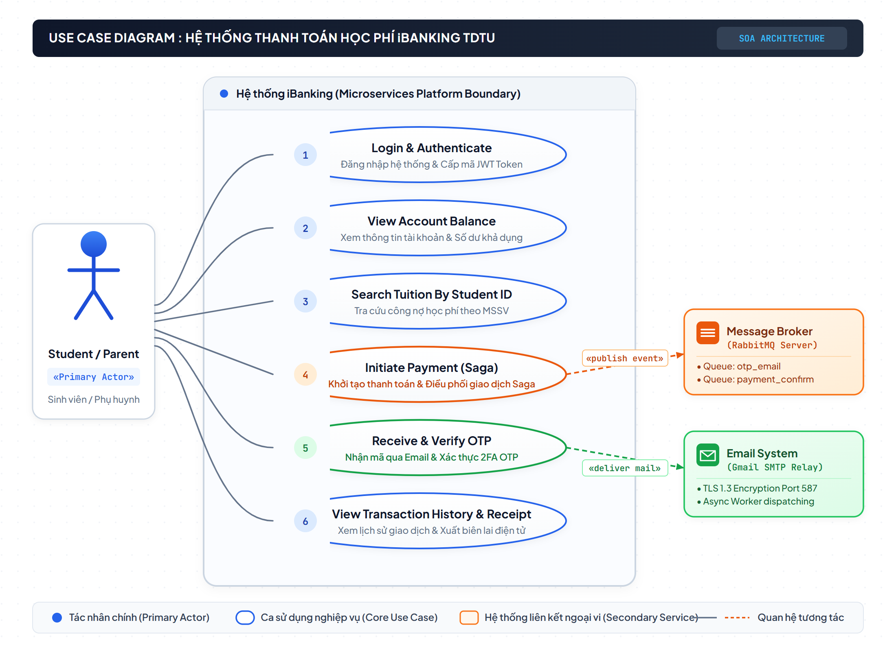
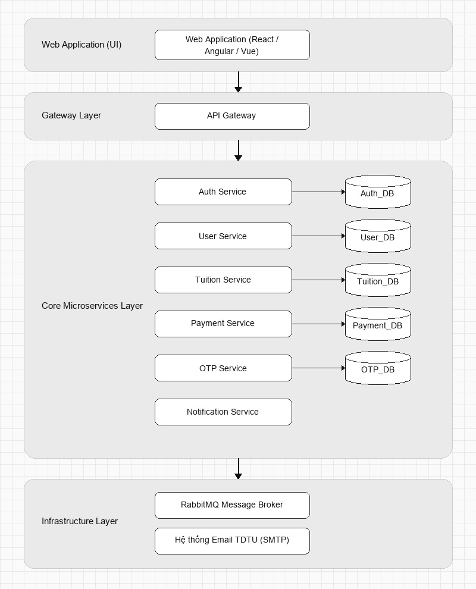
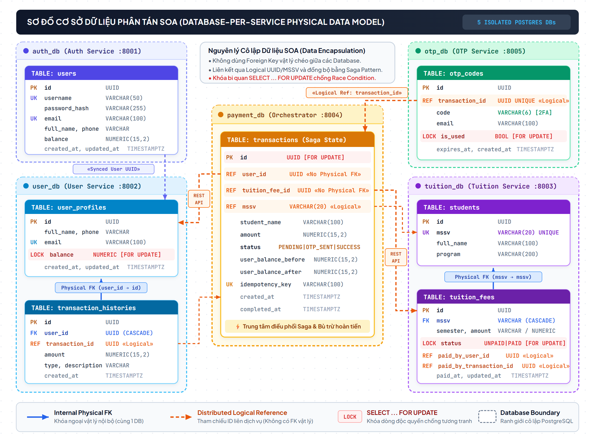
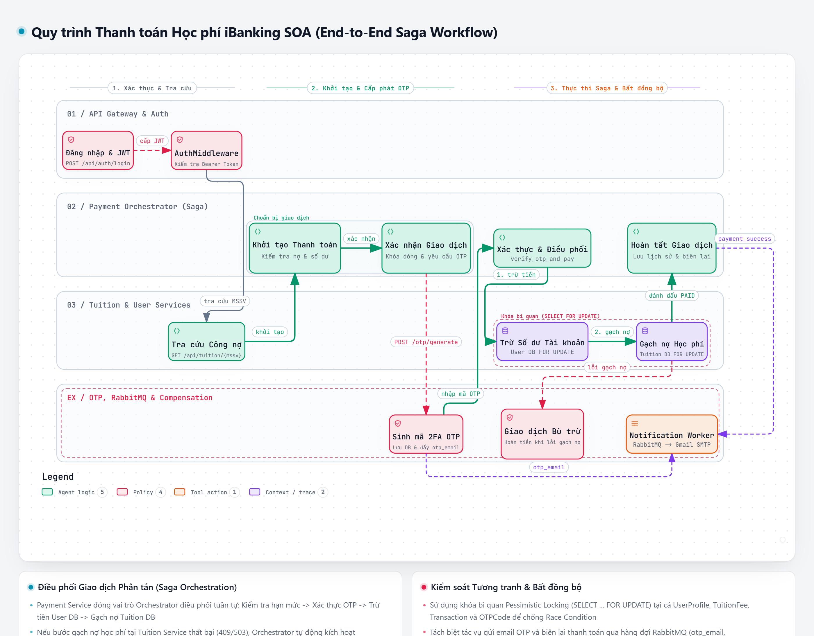
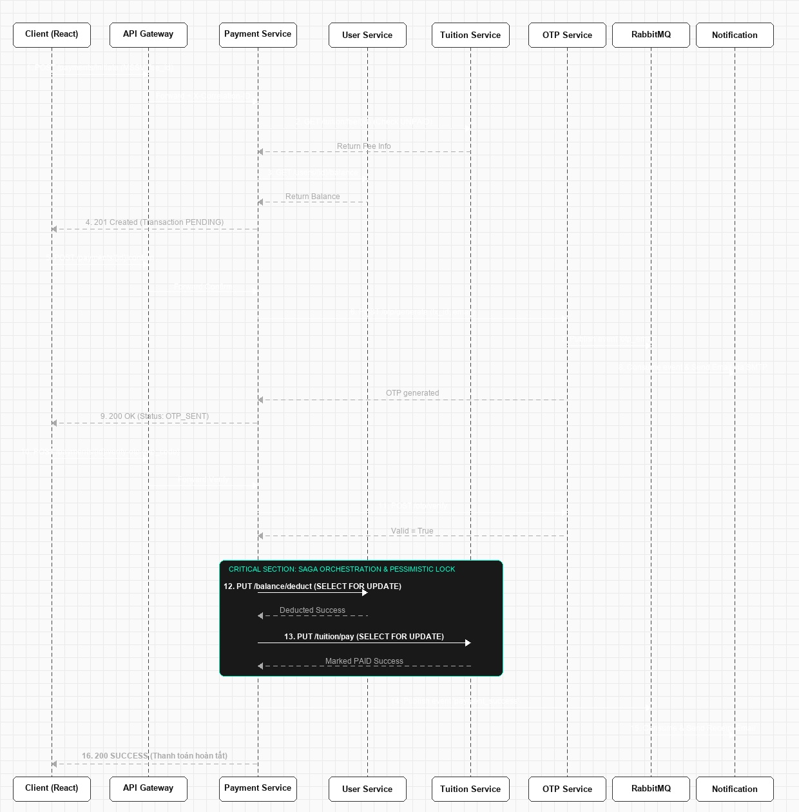

# MIDTERM PRESENTATION
## Service-Oriented Architecture (504070)
**Topic:** Online Tuition Payment System (iBanking) — Microservices SOA

**Instructor:** Dương Hữu Phúc, MSc.  
**Group:** SOA.26-19  
**Source Deck:** `docs/Slide_SOA_v2.pptx` (15 Slides)

---

# Team Members & Contribution Rates

| # | Student ID | Full Name | Assigned Responsibilities | Completion |
| --- | --- | --- | --- | --- |
| 1 | 524H0121 | Lê Phú | System Design, API Gateway & 6 Microservices, React UI, Testing, Docker | 100% |
| 2 | 524H0095 | Vũ Giang Huy | System Analysis, UML & ERD Diagrams, Technical Report, Concurrency Testing | 100% |

---

# 1. Overview | System Overview & Use Case Diagram

- **Problem Context:** TDTU online tuition payment via React 18 SPA routed through an API Gateway.
- **Actors & External Systems:**
  - **Student / Parent:** Auth, lookup, pay & OTP.
  - **RabbitMQ & Gmail:** Async email notifications.
- **6 Core Use Cases:**
  1. Login & JWT Authentication
  2. View Real-Time Account Balance
  3. Search Tuition Fee by MSSV
  4. Initiate Payment (Idempotent)
  5. Receive & Verify 6-Digit OTP
  6. View History & E-Receipt



---

# 2. Design | Microservices Architecture & API Gateway

- **Client:** React 18 + Tailwind CSS SPA
- **API Gateway (`:8000`):** Single entry, JWT verify, `X-Correlation-ID` tracing
- **6 Microservices:** Stateless FastAPI services
- **Database-per-Service:** 5 isolated PostgreSQL 16 DBs (no shared tables)
- **Async & External:** RabbitMQ 3.13 + Gmail SMTP

**Why Microservices?**
- Independent scaling of Payment & OTP
- Clear domain & data ownership
- Fault isolation: SMTP never blocks checkout



---

# 2. Design | Service Decomposition & Data Ownership

| Service / Port | Owned Data Store | Core Responsibility & Design Rationale |
| --- | --- | --- |
| `api-gateway :8000` | Stateless (HTTP proxy) | Single entry point, validates HS256 JWT, injects `X-User-ID` & `X-Correlation-ID` |
| `auth-service :8001` | `auth_db` (PostgreSQL) | Credential storage (`bcrypt`), JWT issuance & `/me` identity verification |
| `user-service :8002` | `user_db` (PostgreSQL) | Payer profiles, balance debit/refund (`FOR UPDATE`), `transaction_histories` |
| `tuition-service :8003` | `tuition_db` (PostgreSQL) | Student records & `UNPAID`/`PAID` fees; atomic mark-paid lock (`FOR UPDATE`) |
| `payment-service :8004` | `payment_db` (PostgreSQL) | Saga Orchestrator, `Idempotency-Key` guard, transaction audit state machine |
| `otp-service :8005` | `otp_db` (PostgreSQL) | CSPRNG 6-digit OTP generation, 5m TTL, 1-time verify, 5-attempt lockout |
| `notification-service :8006` | Stateless Worker | Consumes RabbitMQ (`otp_email`, `payment_success`); sends Gmail SMTP w/ retry |

---

# 2. Design | Database-per-Service Physical ERD

- **5 Isolated Databases:**
  - **Solid Lines:** Physical FKs inside `user_db` & `tuition_db`
  - **Dashed Lines:** Logical UUID/MSSV refs across services (no cross-DB JOIN)
- **DB Constraints & Integrity:**
  - **UNIQUE:** `username`, `email`, `mssv`, `idempotency_key`, `otp.transaction_id`
  - **CHECK:** `tuition_fees.amount > 0`; `balance >= amount`
  - **Money type:** `Numeric(15, 2)` (zero float drift)



---

# 2. Design | REST API Design & Validation Contract

| Method & URI (via Gateway `:8000`) | Purpose | Request / Key Headers | HTTP Status Codes |
| --- | --- | --- | --- |
| `POST /api/auth/login` | Authenticate & issue JWT | `{ username, password }` | `200 OK` / `401 Invalid` |
| `GET /api/users/me`, `/me/balance` | Profile & live balance | `Authorization: Bearer <jwt>` | `200 OK` / `401` / `404` |
| `GET /api/tuition/{mssv}` | Lookup student & UNPAID fees | Path: `mssv` | `200 OK` / `404 Not Found` |
| `POST /api/payments/initiate` | Pre-check & create `PENDING` tx | `Idempotency-Key` + `{mssv, fee_id}` | `201 Created` / `400` / `409` |
| `POST /api/payments/{id}/confirm` | Trigger OTP gen & RabbitMQ email | Bearer JWT (owner check) | `200 OTP_SENT` / `403` / `400` |
| `POST /api/payments/{id}/verify-otp` | Verify OTP & run Saga debit+pay | `{ otp_code }` | `200` / `401` / `409` / `429` |
| `GET /api/payments` | Paginated audit history | `?page=1&size=10` | `200 OK` / `401` |

> **Contract Standards:** Pydantic v2 schema validation auto-returns `422 Unprocessable Entity`; unified JSON errors `{"detail": "..."}`; OpenAPI `/docs` on every service.

---

# 3. Solutions | End-to-End Payment Workflow

1. **Auth & JWT:** Gateway verifies token & sets `X-User-ID`.
2. **Tuition Inquiry:** Fetch `UNPAID` fees by MSSV.
3. **Initiate & Dedup:** `Idempotency-Key` check; verify balance & status.
4. **Async OTP Email:** Generate 6-digit OTP; push email via RabbitMQ.
5. **Saga & Receipt:** Verify OTP → deduct → `PAID` (or refund) → e-receipt.



---

# 3. Solutions | OTP Two-Factor Verification & Security

**1. Generation & Transaction Binding**
- **CSPRNG Generator:** Uses Python `secrets.choice("0123456789")` instead of predictable PRNG `random`.
- **1:1 Transaction Binding:** `otp_codes.transaction_id` has `UNIQUE` constraint — one active OTP per payment.
- **Atomic Resend Lock:** `SELECT ... FOR UPDATE` deletes prior OTP before issuing a fresh code.
- **Async Delivery:** Published to `otp_email` queue and delivered via Gmail SMTP.

**2. Lifecycle & Security Hardening**
- **5-Minute TTL:** Strict UTC expiry check (`expires_at <= now -> HTTP 400`).
- **Single-Use Flag:** Row locked via `FOR UPDATE`, verified once and marked `is_used = True`.
- **Brute-Force Lockout:** Tracks `failed_attempts`; locks OTP at 5 wrong guesses with `HTTP 429`.
- **Zero Leakage:** Constant-time `secrets.compare_digest`; OTP omitted from API & logs when `OTP_DEBUG_EXPOSE=false`.

---

# 3. Solutions | Saga Pattern & Distributed Transaction

**Why Saga over 2PC?**
- Avoids cross-DB distributed locks across 5 PostgreSQL DBs.
- **Model:** Local ACID per DB + **Eventual Consistency**.

**Orchestrator: PaymentService**
- **States:** `PENDING -> OTP_SENT -> SUCCESS | FAILED | REFUNDED`
- **Step A:** `PUT /users/{id}/balance` (`deduct`).
- **Step B:** `PUT /tuition/fee/{id}/pay` (`PAID`).
- **Compensate:** If Step B returns `409`/`503`, immediately call `refund` and mark `REFUNDED`.



---

# 3. Solutions | Concurrency Control (Pessimistic Lock)

- **Scenario 1 (Single Account Double-Spending):** 1 user sends 2 concurrent payments where `total > balance`. `user-service` acquires row lock on `user_profiles`. Tx 1 deducts; Tx 2 waits, sees insufficient funds -> `400` (`FAILED`). Zero negative balance.
- **Scenario 2 (Multi-Account Same Tuition Fee):** 2 users pay the same `tuition_fee_id` simultaneously. `tuition-service` acquires row lock on `tuition_fees`. User 1 marks `PAID` (`200`); User 2 sees `PAID` -> `409 Conflict` -> automatic Saga Refund (`REFUNDED`).

```python
# services/user-service/app/service.py & services/tuition-service/app/service.py
stmt = select(UserProfile).where(UserProfile.id == user_id).with_for_update()
user = (await db.execute(stmt)).scalar_one_or_none()
if user.balance < amount:
    raise HTTPException(status_code=400, detail="Insufficient balance")
```

---

# 3. Solutions | Async Messaging (RabbitMQ) & Tracing

`otp-service / payment-service` → **RabbitMQ 3.13** (`otp_email`, `payment_success`) → **Notification Worker (`aio-pika`)** → **Gmail SMTP (`aiosmtplib`)**

- **Non-blocking Checkout:** Decouples 1-3s Gmail SMTP I/O from payment critical path.
- **Exponential Backoff Retry:** `consumer.py` retries transient failures 3 times (`1s -> 2s -> 4s`) before dead-lettering.
- **X-Correlation-ID Propagation:** Gateway assigns UUID per request and forwards it across all internal HTTP calls and RabbitMQ JSON payloads for end-to-end log tracing.

---

# 4. Demo Plan | Testing, Docker & 5-Min Live Demo Plan

**Automated Testing & Docker Compose Packaging**
- `tests/test_otp_and_saga.py`: 8 `pytest` tests covering OTP TTL, single-use, `429` lockout, idempotency & Saga compensation.
- `scripts/test_concurrency_scenarios.py`: Live E2E assertions for both concurrency cases.
- 10 Docker containers (`postgres`, `rabbitmq`, `gateway`, 6 services, `frontend`) with `healthcheck` + `depends_on: service_healthy` and 1-click `run.py` / `start.bat`.

**5-Minute Live Demo Sequence**
1. **Auth & Balance:** Login (`lephu`), inspect JWT & live `80,000,000 VND` balance.
2. **Tuition Inquiry:** Search MSSV `52100002` -> show `UNPAID` semesters -> initiate payment.
3. **Email OTP & Settlement:** Open real Gmail inbox -> enter 6-digit OTP -> verify deducted balance, `PAID` badge, history & e-receipt.
4. **Concurrency Proof:** Run `python scripts/test_concurrency_scenarios.py` live for Scenario 1 (`400`) & Scenario 2 (`409` + Refund).
5. **DB & Logs:** Inspect PostgreSQL rows + correlation logs.

---

# 5. Evaluation | Trade-offs & Rubric 10/10 Coverage

**Engineering Trade-offs & Future Hardening**
- *Eventual Consistency:* Brief transient state while Saga deducts then marks tuition `PAID`.
- *Row-Lock Contention:* `FOR UPDATE` serializes hot rows; safe & strictly consistent for banking.
- *Internal HTTP Latency:* Sync REST hops add overhead -> mitigate w/ gRPC, Transactional Outbox Pattern & OpenTelemetry tracing.

| Rubric Criterion (10.0 pts) | Evidence in Slide & Codebase |
| --- | --- |
| 1. UML & ERD (1.0) | Use Case + Conceptual & Distributed Physical ERD (Slides 3, 6) |
| 2. Microservices (1.5) | API Gateway + 6 services + RabbitMQ/SMTP + rationale (Slides 4-5) |
| 3. REST API (1.0) | Full CRUD/Payment URIs, Pydantic `422`, OpenAPI `/docs` (Slide 7) |
| 4. DB & Persistence (1.0) | 5 PostgreSQL DBs, `Numeric(15,2)`, `UNIQUE`/`CHECK`, `seed_data.py` |
| 5. Payment & OTP (2.0) | End-to-end flow + CSPRNG, 5m TTL, 1-time, `429` lockout (Slides 8-9) |
| 6. Concurrency (1.5) | `FOR UPDATE` + Saga Refund + E2E concurrency script (Slides 10-11) |
| 7. UI Integration (0.5) | React 18 SPA connected via API Gateway `:8000` (Live Demo) |
| 8. Docs & Level 10 (1.5) | Pytest (8 tests), `Idempotency-Key`, `Correlation-ID`, Docker Compose |

---

# Thank You for Your Attention

**Live System Demo  •  Automated Concurrency Test  •  Q&A Session**  
*Group SOA.26-19 — Service-Oriented Architecture (504070)*
